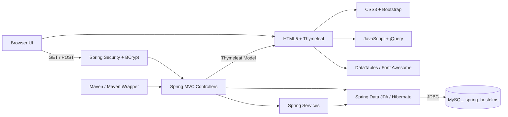
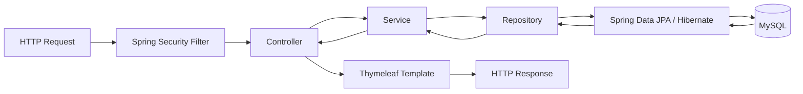
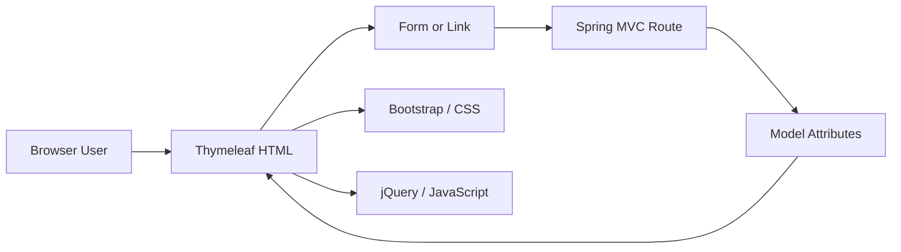
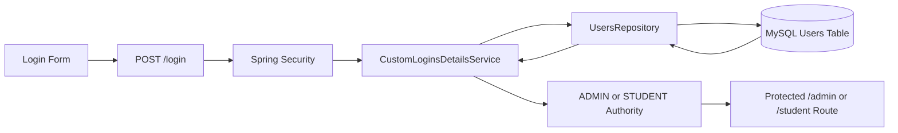
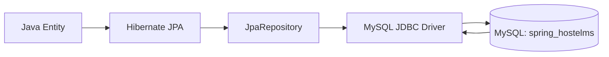
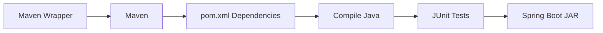

# HostelMS - Complete Project Documentation

This document combines the architecture, feature trace, endpoint inventory, authentication, scalability analysis, and interview-oriented technology guide discussed in this chat.

---

## 1. High-Level Architecture

### Project Type

HostelMS is a server-rendered Spring MVC monolith. It does not show evidence of a separate SPA or standalone REST API.

Evidence:
- [AdminController.java](D:/HostelMS/src/main/java/com/project/hostelms/controller/AdminController.java)
- [StudentController.java](D:/HostelMS/src/main/java/com/project/hostelms/controller/StudentController.java)

### Main Folders

- Java backend: [src/main/java/com/project/hostelms/](D:/HostelMS/src/main/java/com/project/hostelms/)
- Thymeleaf pages: [src/main/resources/templates/](D:/HostelMS/src/main/resources/templates/)
- CSS, JavaScript and images: [src/main/resources/static/](D:/HostelMS/src/main/resources/static/)
- Tests: [src/test/java/](D:/HostelMS/src/test/java/)

### Frontend

- Browser requests Thymeleaf HTML templates.
- Static assets are served from `static`.
- Example login form: [login.html](D:/HostelMS/src/main/resources/templates/login.html)
- Static assets: [src/main/resources/static/assets/](D:/HostelMS/src/main/resources/static/assets/)

### Backend

The backend is organized approximately as:

```text
Browser
  -> Spring MVC Controller
  -> Spring Service
  -> Spring Data JPA Repository
  -> Hibernate/JPA
  -> MySQL
```

Evidence:
- [AdminController.java](D:/HostelMS/src/main/java/com/project/hostelms/controller/AdminController.java)
- [AdminServiceImpl.java](D:/HostelMS/src/main/java/com/project/hostelms/service/impl/AdminServiceImpl.java)
- [AdminService.java](D:/HostelMS/src/main/java/com/project/hostelms/service/AdminService.java)

### Database

JPA entities and repositories connect to MySQL through JDBC.

- Database name: `spring_hostelms`
- JDBC port: `3306`
- DDL setting: `spring.jpa.hibernate.ddl-auto=update`

Evidence:
- [application.properties](D:/HostelMS/src/main/resources/application.properties)
- [Student.java](D:/HostelMS/src/main/java/com/project/hostelms/entity/Student.java)
- [StudentRepository.java](D:/HostelMS/src/main/java/com/project/hostelms/repository/StudentRepository.java)
- [SQL dump](D:/HostelMS/127_0_0_1_spring_hostelms.sql)

### Security

Spring Security applies `ADMIN` and `STUDENT` authorization and BCrypt password hashing.

Evidence:
- [SpringSecurity.java](D:/HostelMS/src/main/java/com/project/hostelms/config/SpringSecurity.java)
- [CustomLoginsDetailsService.java](D:/HostelMS/src/main/java/com/project/hostelms/security/CustomLoginsDetailsService.java)

---

## 2. Tech Stack

- Java 17
- Spring Boot
- Spring MVC
- Spring Data JPA
- Hibernate/JPA
- Thymeleaf
- Spring Security
- BCrypt
- MySQL
- MySQL Connector/J
- Maven
- Maven Wrapper
- HTML5
- CSS3
- Bootstrap
- JavaScript
- jQuery
- DataTables
- Font Awesome
- widgEditor
- Lombok
- Spring Boot DevTools
- JUnit 5
- Spring Boot Test

Evidence:
- [pom.xml](D:/HostelMS/pom.xml)
- [application.properties](D:/HostelMS/src/main/resources/application.properties)
- [README.md](D:/HostelMS/README.md)

UNCLEAR: Docker, Kubernetes, GitHub Actions, CI/CD pipelines and cloud deployment configuration are not found.

---

## 3. End-to-End: Admin Dashboard

### UI

The administrator clicks **Dashboard** in the sidebar. This sends:

```text
GET /admin/dashboard
```

Evidence:
- [base.html](D:/HostelMS/src/main/resources/templates/admin/base.html:30)

### Authentication and Redirect

After login, `/` redirects an authenticated administrator to `/admin/dashboard`.

Evidence:
- [StudentController.java](D:/HostelMS/src/main/java/com/project/hostelms/controller/StudentController.java:62)
- [SpringSecurity.java](D:/HostelMS/src/main/java/com/project/hostelms/config/SpringSecurity.java:38)

### Route Protection

Spring Security requires authority `ADMIN` for `/admin/**`.

Evidence:
- [SpringSecurity.java](D:/HostelMS/src/main/java/com/project/hostelms/config/SpringSecurity.java:31)

### Login Lookup

The login service:

1. Loads the user by username.
2. Verifies account status.
3. Compares the submitted password using BCrypt.

Evidence:
- [CustomLoginsDetailsService.java](D:/HostelMS/src/main/java/com/project/hostelms/security/CustomLoginsDetailsService.java:28)
- [UsersRepository.java](D:/HostelMS/src/main/java/com/project/hostelms/repository/UsersRepository.java:11)

### Controller

`AdminController.dashboard()` handles `GET /admin/dashboard`.

Evidence:
- [AdminController.java](D:/HostelMS/src/main/java/com/project/hostelms/controller/AdminController.java:80)

### Database Calls

The dashboard:

- Counts blocks using `blocks.count()`.
- Counts rooms using `rooms.count()`.
- Counts occupied/staying room records using `roomstatus.countByStatus(1)`.
- Retrieves pending registration requests using `regrequests.findByStatusOrderByIdDesc(1)`.

Evidence:
- [AdminController.java](D:/HostelMS/src/main/java/com/project/hostelms/controller/AdminController.java:82)
- [RoomStudentRepository.java](D:/HostelMS/src/main/java/com/project/hostelms/repository/RoomStudentRepository.java:14)
- [RegistrationRequestRepository.java](D:/HostelMS/src/main/java/com/project/hostelms/repository/RegistrationRequestRepository.java:11)

### Database Connection

Spring Data JPA/Hibernate translates these calls into MySQL queries. The configuration points to:

```text
jdbc:mysql://localhost:3306/spring_hostelms
```

Evidence:
- [application.properties](D:/HostelMS/src/main/resources/application.properties:1)

### Response

The controller adds model values and returns `admin/dashboard`. Thymeleaf renders:

- Blocks
- Rooms
- Students staying
- Pending registrations

Evidence:
- [AdminController.java](D:/HostelMS/src/main/java/com/project/hostelms/controller/AdminController.java:87)
- [dashboard.html](D:/HostelMS/src/main/resources/templates/admin/dashboard.html:16)

This is a server-rendered MVC flow. UNCLEAR whether a separate dashboard REST API exists because no such endpoint was found.

---

## 4. End-to-End: Login

### 1. UI Submission

The login form submits:

```text
POST /login
username=<email>
password=<password>
```

Evidence:
- [login.html](D:/HostelMS/src/main/resources/templates/login.html:27)

### 2. Login Page Route

`GET /login` renders the login page or redirects an already authenticated user to the role dashboard.

Evidence:
- [StudentController.java](D:/HostelMS/src/main/java/com/project/hostelms/controller/StudentController.java:188)

### 3. Authentication Route

`POST /login` is handled by Spring Security form login; no custom login controller handles the password POST.

Evidence:
- [SpringSecurity.java](D:/HostelMS/src/main/java/com/project/hostelms/config/SpringSecurity.java:33)

### 4. User Lookup

Spring calls:

```java
CustomLoginsDetailsService.loadUserByUsername(username)
```

This calls `UsersRepository.findByUsername()`.

Evidence:
- [CustomLoginsDetailsService.java](D:/HostelMS/src/main/java/com/project/hostelms/security/CustomLoginsDetailsService.java:28)
- [UsersRepository.java](D:/HostelMS/src/main/java/com/project/hostelms/repository/UsersRepository.java:11)

### 5. Entity

The `Users` entity stores:

- `id`
- `username`
- `fullname`
- `mobilenumber`
- `password`
- `type`
- `status`

Evidence:
- [Users.java](D:/HostelMS/src/main/java/com/project/hostelms/entity/Users.java:13)

### 6. Validation

Authentication fails when:

- No user is found.
- `status != 1`.
- The submitted password does not match the BCrypt hash.

Evidence:
- [CustomLoginsDetailsService.java](D:/HostelMS/src/main/java/com/project/hostelms/security/CustomLoginsDetailsService.java:31)
- [SpringSecurity.java](D:/HostelMS/src/main/java/com/project/hostelms/config/SpringSecurity.java:24)

### 7. Authority Assignment

The user's `type` becomes a Spring authority, normally `ADMIN` or `STUDENT`.

Evidence:
- [CustomLoginsDetailsService.java](D:/HostelMS/src/main/java/com/project/hostelms/security/CustomLoginsDetailsService.java:41)
- [LoginTypes.java](D:/HostelMS/src/main/java/com/project/hostelms/LoginTypes.java:3)

### 8. Success Redirect

Spring redirects success to `/`. `/` redirects to:

- `/admin/dashboard` for `ADMIN`
- `/student/dashboard` for `STUDENT`

Evidence:
- [SpringSecurity.java](D:/HostelMS/src/main/java/com/project/hostelms/config/SpringSecurity.java:40)
- [StudentController.java](D:/HostelMS/src/main/java/com/project/hostelms/controller/StudentController.java:62)

### 9. Failure Response

Spring redirects to `/login?error`. Thymeleaf displays:

```text
Invalid Username or Password
```

Evidence:
- [login.html](D:/HostelMS/src/main/resources/templates/login.html:42)

UNCLEAR: The remember-me checkbox is submitted, but no remember-me configuration is visible.

---

## 5. API and MVC Route Inventory

These are primarily MVC routes and AJAX-style server endpoints. They do not appear to form a separate REST API.

### Public and Authentication Routes

| Method | Route | Purpose | Models/Collections |
|---|---|---|---|
| GET | `/` | Redirect authenticated users or to login | `Authentication`, `Users` |
| GET | `/signup` | Display registration form | `Department`, `Course` |
| POST | `/checkAvailability` | Check whether email is registered | `Users` |
| POST | `/registerdb` | Submit student registration | `RegistrationRequest`, `Users`, `Student` |
| GET | `/login` | Display login or redirect authenticated user | `Authentication`, `Users` |
| POST | `/login` | Authenticate using Spring Security | `Users`, BCrypt password |
| POST | `/logout` | End session | Spring Security session |
| POST | `/loadcourses` | Load courses for department | `Course`, `Department` |

Evidence:
- [StudentController.java](D:/HostelMS/src/main/java/com/project/hostelms/controller/StudentController.java)
- [SpringSecurity.java](D:/HostelMS/src/main/java/com/project/hostelms/config/SpringSecurity.java)

### Student Routes

| Method | Route | Purpose | Models/Collections |
|---|---|---|---|
| GET | `/student` | Redirect to dashboard | None |
| GET | `/student/dashboard` | Show unpaid fees and balance | `Users`, `Studentmonthlyfees`, `Room` |
| GET | `/student/rooms` | List room allocations | `RoomStudent`, `Room`, `Block` |
| GET | `/student/monthlyfees` | List fee history and balance | `Studentmonthlyfees`, `Room`, `Users` |
| GET | `/student/changepassword` | Display password form | `Users` |
| GET | `/student/myprofile` | Display profile | `Users`, `Student` |
| POST | `/student/updatepassword` | Update password | `Users` |
| POST | `/student/updateprofile` | Update name/mobile | `Users` |
| GET | `/student/complaints` | List complaints and rooms | `Complaint`, `RoomStudent`, `Room`, `Block` |
| POST | `/student/addcomplaintdb` | Lodge complaint | `Complaint` |
| POST | `/student/addcomplaintcommentdb` | Add complaint comment | `Complaintcomments` |
| GET | `/student/getcomplaint/{id}` | Retrieve complaint details | `Complaint`, `Room`, `Block`, `Complaintcomments` |
| GET | `/student/visitors` | List visitor requests | `Visitor`, `RoomStudent`, `Room`, `Block` |
| POST | `/student/addvisitordb` | Lodge visitor request | `Visitor` |
| POST | `/student/removevisitorentry/{id}` | Mark visitor inactive | `Visitor` |

Evidence:
- [StudentController.java](D:/HostelMS/src/main/java/com/project/hostelms/controller/StudentController.java)

### Admin Routes

| Method | Route | Purpose | Models/Collections |
|---|---|---|---|
| GET | `/admin` | Redirect to dashboard | None |
| GET | `/admin/dashboard` | Show dashboard counts | `Block`, `Room`, `RoomStudent`, `RegistrationRequest` |
| GET | `/admin/visitors` | Display visitor page | `Block` |
| POST | `/admin/getvisitors` | Return visitor records | `Visitor`, `Room`, `Block`, `Users` |
| GET | `/admin/changepassword` | Display password form | `Users` |
| POST | `/admin/updatepassword` | Update password | `Users` |
| GET | `/admin/registrationrequests` | List pending registrations | `RegistrationRequest`, `Course` |
| GET | `/admin/registartionaction/{id}/{status}` | Approve/reject registration | `RegistrationRequest`, `Users`, `Student` |
| GET | `/admin/blocks` | Display block page | `Block` |
| POST | `/admin/block` | CRUD blocks | `Block`, `Room` |
| GET | `/admin/rooms`, `/admin/rooms/{id}` | Display rooms | `Room`, `Block` |
| POST | `/admin/room` | CRUD rooms | `Room`, `Block` |
| GET | `/admin/courses`, `/admin/courses/{id}` | Display courses | `Course`, `Department` |
| POST | `/admin/course` | CRUD courses | `Course`, `Department` |
| GET | `/admin/members` | List student users | `Users`, `Student` |
| POST | `/admin/changeuserstatus/{id}/{status}` | Enable/disable user | `Users` |
| GET | `/admin/profile` | Display profile | `Users` |
| POST | `/admin/updateprofile` | Update profile | `Users` |
| GET | `/admin/complaints` | List complaints | `Complaint`, `Users`, `Complaintcomments` |
| POST | `/admin/addcomplaintcommentdb` | Reply/update complaint | `Complaint`, `Complaintcomments`, `Users` |
| GET | `/admin/getcomplaint/{id}` | Retrieve complaint details | `Complaint`, `Room`, `Block`, `Complaintcomments` |
| GET | `/admin/addnoticeboard` | Display notice form | `Noticeboard` |
| GET | `/admin/noticeboard` | Display notice page | `Noticeboard` |
| GET | `/admin/editnoticeboard/{id}` | Load notice | `Noticeboard` |
| POST | `/admin/noticeboard` | CRUD notices | `Noticeboard` |
| GET | `/admin/departments` | Display department page | `Department` |
| POST | `/admin/department` | CRUD departments | `Department` |
| GET | `/admin/addstudent` | Display student form | `Department`, `Course` |
| GET | `/admin/studentmanage` | Display student page | `Users`, `Student` |
| GET | `/admin/editstudent/{id}` | Load student | `Student`, `Users`, `Department` |
| POST | `/admin/student` | CRUD/search students | `Users`, `Student`, `Course`, `Room`, `RoomStudent` |
| GET | `/admin/allocateroom` | Display allocation page | `RoomStudent`, `Room`, `Users` |
| GET | `/admin/roomallocation/{id}` | Display room allocations | `RoomStudent`, `Room` |
| POST | `/admin/allocateroom` | List/allocate/deallocate rooms | `RoomStudent`, `Room`, `Block`, `Users` |
| GET | `/admin/settings` | Display settings | `Setting` |
| POST | `/admin/savesettings` | Save settings | `Setting` |
| GET | `/admin/generatefees` | Display fee page | `Studentmonthlyfees`, `Setting` |
| POST | `/admin/newgeneratefees` | Generate monthly fees | `Studentmonthlyfees`, `RoomStudent`, `Room`, `Users`, `Setting` |
| GET | `/admin/managefees` | Display fee-management page | `Studentmonthlyfees` |
| POST | `/admin/fetchfees` | Fetch monthly fees | `Studentmonthlyfees`, `Room`, `Users` |
| POST | `/admin/feespaid` | Mark fee paid | `Studentmonthlyfees` |

Evidence:
- [AdminController.java](D:/HostelMS/src/main/java/com/project/hostelms/controller/AdminController.java)

The project appears to expose only `GET` and `POST` mappings. UNCLEAR: no additional HTTP methods are mapped elsewhere.

---

## 6. Authentication and Authorization

### Authentication

1. Login form sends username and password to `POST /login`.
2. Spring Security invokes `CustomLoginsDetailsService.loadUserByUsername()`.
3. `UsersRepository.findByUsername()` searches `users.username`.
4. Authentication fails if user is missing or `status != 1`.
5. BCrypt compares the submitted password with the stored hash.
6. Success creates an authenticated Spring Security session.
7. Failure redirects to `login?error`.

Evidence:
- [login.html](D:/HostelMS/src/main/resources/templates/login.html:27)
- [CustomLoginsDetailsService.java](D:/HostelMS/src/main/java/com/project/hostelms/security/CustomLoginsDetailsService.java:28)
- [UsersRepository.java](D:/HostelMS/src/main/java/com/project/hostelms/repository/UsersRepository.java)
- [SpringSecurity.java](D:/HostelMS/src/main/java/com/project/hostelms/config/SpringSecurity.java)

### Authorization

- `Users.type` becomes a Spring authority.
- `ADMIN` can access `/admin/**`.
- `STUDENT` can access `/student/**`.
- Public routes include `/`, assets, signup, registration, course loading and login.
- Unauthenticated or unauthorized access uses the configured access-denied redirect behavior.

Evidence:
- [LoginTypes.java](D:/HostelMS/src/main/java/com/project/hostelms/LoginTypes.java)
- [CustomLoginsDetailsService.java](D:/HostelMS/src/main/java/com/project/hostelms/security/CustomLoginsDetailsService.java:41)
- [SpringSecurity.java](D:/HostelMS/src/main/java/com/project/hostelms/config/SpringSecurity.java:31)

For later requests, controllers obtain the current username using `SecurityContextHolder`.

Evidence:
- [StudentController.java](D:/HostelMS/src/main/java/com/project/hostelms/controller/StudentController.java:243)
- [AdminController.java](D:/HostelMS/src/main/java/com/project/hostelms/controller/AdminController.java:121)

### Security Notes

- CSRF protection is disabled.
- Remember-me behavior is UNCLEAR.
- Object-level ownership checks are not consistently visible.
- Unauthorized access is redirected to `/`.

---

## 7. Weak Points and Improvements

### 1. CSRF Disabled

CSRF protection is disabled, creating a cross-site request forgery risk for state-changing POST routes.

Evidence:
- [SpringSecurity.java](D:/HostelMS/src/main/java/com/project/hostelms/config/SpringSecurity.java:25)

### 2. Weak Object-Level Authorization

Route checks are mostly based on role alone. Student complaint and visitor operations may need explicit checks that the record belongs to the authenticated user.

Evidence:
- [SpringSecurity.java](D:/HostelMS/src/main/java/com/project/hostelms/config/SpringSecurity.java:31)

### 3. No Pagination

Multiple pages call `findAll()` and build in-memory lists.

Evidence:
- [AdminController.java](D:/HostelMS/src/main/java/com/project/hostelms/controller/AdminController.java:284)
- [StudentController.java](D:/HostelMS/src/main/java/com/project/hostelms/controller/StudentController.java:413)

### 4. N+1 Query Risk

Loops repeatedly call `findById()` and derive one related value at a time.

Evidence:
- [AdminController.java](D:/HostelMS/src/main/java/com/project/hostelms/controller/AdminController.java:1218)
- [AdminController.java](D:/HostelMS/src/main/java/com/project/hostelms/controller/AdminController.java:1352)

### 5. Missing Transactions and Concurrency Control

Room allocation can exceed capacity or create duplicate records. Fee generation also performs many writes without clear transaction or locking control.

Evidence:
- [AdminController.java](D:/HostelMS/src/main/java/com/project/hostelms/controller/AdminController.java:1218)
- [RoomStudent.java](D:/HostelMS/src/main/java/com/project/hostelms/entity/RoomStudent.java:12)

### 6. Production Schema Management

`spring.jpa.hibernate.ddl-auto=update` is not enough for controlled production migrations.

Evidence:
- [application.properties](D:/HostelMS/src/main/resources/application.properties:5)

### 7. Test Coverage

The existing test only loads the Spring context and does not exercise major flows.

Evidence:
- [OsfsystemApplicationTests.java](D:/HostelMS/src/test/java/com/project/osfsystem/OsfsystemApplicationTests.java:1)

### 8. Error Handling

The global exception handler exposes exception messages and assumes `error.html` exists, which may need correction.

Evidence:
- [GlobalExceptionHandler.java](D:/HostelMS/src/main/java/com/project/hostelms/exception/GlobalExceptionHandler.java:8)

### 9. Broad Exception Handling

Broad catches can hide service failures or make endpoints return success-shaped responses.

Evidence:
- [AdminController.java](D:/HostelMS/src/main/java/com/project/hostelms/controller/AdminController.java:160)
- [StudentController.java](D:/HostelMS/src/main/java/com/project/hostelms/controller/StudentController.java:664)

### 10. Large Controllers

Controllers contain HTTP parsing, business rules and persistence logic. This makes testing and change management harder.

Evidence:
- [AdminController.java](D:/HostelMS/src/main/java/com/project/hostelms/controller/AdminController.java:177)

---

## 8. Changes for 10× Users

1. Re-enable CSRF and add method-level ownership checks.
2. Add pagination and repository query projections.
3. Add indexes for frequent lookups.
4. Replace N+1 loops with joins or batch queries.
5. Put allocation and fee operations in `@Transactional` service methods.
6. Use optimistic or pessimistic locking where concurrent writes can conflict.
7. Run monthly fee generation as an idempotent background job.
8. Cache settings and dashboard counts, for example with Redis.
9. Run multiple stateless application instances behind a load balancer.
10. Add a read replica or reporting database if reporting load grows.
11. Replace loose controller return maps with explicit DTOs and validation.
12. Use Flyway or Liquibase for database migrations.
13. Add integration, security and load tests.
14. Add metrics, health checks and distributed tracing.

Recommended priority:

```text
Security -> Transaction Correctness -> Query Optimization -> Infrastructure Scaling
```

---

## 9. Technology Explanations

## Java 17

**What it is**

Java is the main programming language. Java 17 is the configured language level.

**Why it is used here**

It implements controllers, services, entities and repositories.

Evidence:
- [pom.xml](D:/HostelMS/pom.xml:12)

**Key concepts**

- Classes
- Objects
- Interfaces
- Inheritance
- Annotations
- Exceptions

**Example**

```java
@SpringBootApplication
public class hostelmsApplication {
    public static void main(String[] args) {
        SpringApplication.run(hostelmsApplication.class, args);
    }
}
```

- `hostelmsApplication` is the Java entry class.
- `main` is the JVM entry method.
- `SpringApplication.run(...)` starts Spring.
- `@SpringBootApplication` enables configuration and component discovery.

Evidence:
- [hostelmsApplication.java](D:/HostelMS/src/main/java/com/project/hostelms/hostelmsApplication.java:3)

---

## Spring Boot

**What it is**

Spring Boot configures and starts Spring applications using convention and embedded server support.

**Why it is used here**

It provides Spring MVC, JPA, Security and Thymeleaf through starter dependencies.

Evidence:
- [pom.xml](D:/HostelMS/pom.xml:4)

**Key concepts**

- `@SpringBootApplication`
- Auto-configuration
- Embedded server
- Starter dependencies
- Application properties
- Component scanning

**Example**

```java
@SpringBootApplication
public class hostelmsApplication {
    public static void main(String[] args) {
        SpringApplication.run(hostelmsApplication.class, args);
    }
}
```

The annotation enables component discovery and auto-configuration. `run` creates the Spring context and starts the application.

Evidence:
- [hostelmsApplication.java](D:/HostelMS/src/main/java/com/project/hostelms/hostelmsApplication.java:3)

---

## Spring MVC

**What it is**

Spring MVC handles HTTP requests and maps requests to Java methods.

**Why it is used here**

Controllers produce rendered Thymeleaf pages and AJAX-style map responses.

Evidence:
- [AdminController.java](D:/HostelMS/src/main/java/com/project/hostelms/controller/AdminController.java:80)

**Key concepts**

- `@Controller`
- `@GetMapping`
- `@PostMapping`
- `@ResponseBody`
- `Model`
- Request parameters
- Path variables

**Example**

```java
@GetMapping("/admin/dashboard")
public String dashboard(Model model) {
    model.addAttribute("blocks", blocks.count());
    return "admin/dashboard";
}
```

- `@GetMapping` handles `GET /admin/dashboard`.
- `Model` carries values to the template.
- `blocks.count()` reads the database count.
- `admin/dashboard` selects the Thymeleaf template.

Evidence:
- [AdminController.java](D:/HostelMS/src/main/java/com/project/hostelms/controller/AdminController.java:80)

---

## Spring Services

**What it is**

Spring services contain reusable business logic between controllers and repositories.

**Why it is used here**

The project uses `AdminServiceImpl` for registration and visitor operations.

Evidence:
- [AdminServiceImpl.java](D:/HostelMS/src/main/java/com/project/hostelms/service/impl/AdminServiceImpl.java:16)

**Key concepts**

- `@Service`
- Dependency injection
- Interfaces
- Implementations
- `@Autowired`
- Separation of concerns

**Example**

```java
@Service
public class AdminServiceImpl implements AdminService {
    @Autowired
    private VisitorRepository visitors;
}
```

- `@Service` makes the class injectable.
- `implements AdminService` fulfills a service interface.
- `@Autowired` injects the repository implementation.

Evidence:
- [AdminServiceImpl.java](D:/HostelMS/src/main/java/com/project/hostelms/service/impl/AdminServiceImpl.java:16)

---

## HTML5

**What it is**

HTML is the markup language used to build pages and forms.

**Why it is used here**

Thymeleaf templates contain login, dashboard and management interfaces.

Evidence:
- [src/main/resources/templates/](D:/HostelMS/src/main/resources/templates/)

**Key concepts**

- `<html>`
- `<head>`
- `<body>`
- `<form>`
- `<input>`
- `<a>`
- Semantic structure

**Example**

```html
<form action="/login" method="POST">
    <input name="username" type="email">
    <input name="password" type="password">
    <button>Login</button>
</form>
```

- `form` submits credentials.
- `action` selects `/login`.
- `POST` identifies form submission.
- Inputs are named for Spring Security.

Evidence:
- [login.html](D:/HostelMS/src/main/resources/templates/login.html:27)

---

## Thymeleaf

**What it is**

Thymeleaf is a server-side Java template engine.

**Why it is used here**

Controllers pass model values and templates use `th:text`, `th:if` and fragments.

Evidence:
- [pom.xml](D:/HostelMS/pom.xml:27)

**Key concepts**

- `th:text`
- `th:if`
- `th:each`
- Fragments
- Layout replacement
- Expression syntax
- Spring MVC integration

**Example**

```html
<th:block th:replace="admin/base :: header"></th:block>
<span th:text="${blocks}"></span>
```

- `th:replace` inserts the shared admin header.
- `th:text` renders the `blocks` model value.

Evidence:
- [dashboard.html](D:/HostelMS/src/main/resources/templates/admin/dashboard.html:5)

---

## CSS3

**What it is**

CSS controls layout, colours, typography and responsive behavior.

**Why it is used here**

Custom styles define the admin layout and components.

Evidence:
- [master.css](D:/HostelMS/src/main/resources/static/assets/css/master.css)

**Key concepts**

- Selectors
- Cascade
- Box model
- Flex/grid
- Media queries
- Variables
- Pseudo-classes

**Example**

```css
body,
h1,
p {
    font-family: "Lato";
}
```

- The comma creates a group selector.
- The rule applies `"Lato"` to body text and headings.

Evidence:
- [master.css](D:/HostelMS/src/main/resources/static/assets/css/master.css:49)

---

## Bootstrap

**What it is**

Bootstrap is a responsive CSS and JavaScript component library.

**Why it is used here**

It provides cards, grids, forms and navigation components.

Evidence:
- [base.html](D:/HostelMS/src/main/resources/templates/admin/base.html:14)

**Key concepts**

- Grid system
- Containers
- Rows/columns
- Utility classes
- Cards
- Breakpoints
- Components

**Example**

```html
<div class="container">
    <div class="row">
        <div class="col-md-12">Dashboard</div>
    </div>
</div>
```

- `container` contains the page content.
- `row` creates a row.
- `col-md-12` uses the full width on medium-or-larger screens.

Evidence:
- [dashboard.html](D:/HostelMS/src/main/resources/templates/admin/dashboard.html:12)

---

## JavaScript

**What it is**

JavaScript runs browser behavior and interactive logic.

**Why it is used here**

It toggles the sidebar and validates form input.

Evidence:
- [script.js](D:/HostelMS/src/main/resources/static/assets/js/script.js)

**Key concepts**

- Variables
- Functions
- Events
- DOM access
- Callbacks
- AJAX/fetch

**Example**

```javascript
$('#sidebarCollapse').on('click', function() {
    $('#sidebar').toggleClass('active');
});
```

- `#sidebarCollapse` selects the button.
- `on('click')` listens for a click.
- `toggleClass` switches the `active` CSS class.

Evidence:
- [script.js](D:/HostelMS/src/main/resources/static/assets/js/script.js:28)

---

## jQuery

**What it is**

jQuery simplifies DOM selection and event handling.

**Why it is used here**

The project uses jQuery for menu and form behavior.

Evidence:
- [script.js](D:/HostelMS/src/main/resources/static/assets/js/script.js:28)

**Key concepts**

- `$()`
- Selectors
- Event handlers
- DOM manipulation
- AJAX
- Chaining

**Example**

```javascript
$('input[name=mobile]').on('keypress', function(event) {
    return validatemobile(event);
});
```

- The selector finds the mobile input.
- `keypress` attaches an event listener.
- `validatemobile` checks the entered key.

Evidence:
- [script.js](D:/HostelMS/src/main/resources/static/assets/js/script.js:55)

---

## DataTables

**What it is**

DataTables enhances HTML tables with sorting and searching.

**Why it is used here**

The library is included globally in the admin layout.

Evidence:
- [base.html](D:/HostelMS/src/main/resources/templates/admin/base.html:13)

**Key concepts**

- Table enhancement
- Sorting
- Searching
- Pagination
- Configuration options
- Responsive tables

**Example**

UNCLEAR: the assets are loaded, but no confirmed DataTable initialization was found in the inspected JavaScript.

---

## Font Awesome

**What it is**

Font Awesome provides icon fonts and CSS classes.

**Why it is used here**

The navigation and dashboard use icons such as `fa-building`.

Evidence:
- [base.html](D:/HostelMS/src/main/resources/templates/admin/base.html:10)

**Key concepts**

- Icon classes
- Solid/brand/regular styles
- Sizing
- Color
- Accessibility

**Example**

```html
<i class="teal fas fa-building"></i>
```

- `fas` uses solid-style icons.
- `fa-building` selects the building icon.
- `teal` applies a project-defined class.

Evidence:
- [dashboard.html](D:/HostelMS/src/main/resources/templates/admin/dashboard.html:26)

---

## widgEditor

**What it is**

widgEditor is a browser rich-text editor library.

**Why it is used here**

Its CSS and JavaScript are included in the shared layout.

Evidence:
- [base.html](D:/HostelMS/src/main/resources/templates/admin/base.html:15)

**Key concepts**

- Content editing
- Toolbar
- HTML output
- Form integration
- Sanitization
- Script inclusion

**Example**

UNCLEAR: library files are present, but no confirmed page-specific initialization was found.

---

## Spring Data JPA

**What it is**

Spring Data JPA creates repository implementations for database operations.

**Why it is used here**

Interfaces such as `StudentRepository` provide CRUD and finder methods.

Evidence:
- [pom.xml](D:/HostelMS/pom.xml:17)

**Key concepts**

- Repositories
- Derived queries
- `JpaRepository`
- Entity mapping
- Transactions
- Query methods

**Example**

```java
public interface StudentRepository extends JpaRepository<Student, Integer> {
    Student findByUser(int id);
}
```

- `JpaRepository` supplies CRUD methods.
- `Student` is the entity.
- `Integer` is the key type.
- `findByUser` derives a lookup query.

Evidence:
- [StudentRepository.java](D:/HostelMS/src/main/java/com/project/hostelms/repository/StudentRepository.java:8)

---

## Hibernate/Jakarta Persistence

**What it is**

Hibernate implements JPA and maps Java objects to database tables.

**Why it is used here**

It maps entities, primary keys and table schemas.

Evidence:
- [pom.xml](D:/HostelMS/pom.xml:17)

**Key concepts**

- ORM
- `@Entity`
- `@Table`
- `@Id`
- Generated IDs
- Relationships
- DDL generation

**Example**

```java
@Entity
@Table(name="students")
public class Student {
    @Id
    @GeneratedValue(strategy = GenerationType.IDENTITY)
    private int id;
}
```

- `@Entity` makes `Student` persistable.
- `@Table` maps it to `students`.
- `@Id` marks the primary key.
- `IDENTITY` delegates ID generation to MySQL.

Evidence:
- [Student.java](D:/HostelMS/src/main/java/com/project/hostelms/entity/Student.java:17)

---

## MySQL

**What it is**

MySQL is a relational SQL database.

**Why it is used here**

It stores users, rooms, fees and complaints in `spring_hostelms`.

Evidence:
- [application.properties](D:/HostelMS/src/main/resources/application.properties:1)

**Key concepts**

- Tables
- Rows
- Columns
- Primary keys
- Foreign keys
- Indexes
- Transactions
- SQL

**Example**

The SQL dump creates a `blocks` table.

```sql
CREATE TABLE `blocks` (
  `id` int(11) NOT NULL,
  `name` varchar(255) NOT NULL
);
```

- `id` is an identifier.
- `name` is required text.
- The table stores hostel blocks.

Evidence:
- [127_0_0_1_spring_hostelms.sql](D:/HostelMS/127_0_0_1_spring_hostelms.sql:12)

---

## MySQL Connector/J

**What it is**

MySQL Connector/J is the JDBC driver for MySQL.

**Why it is used here**

It lets Spring use `jdbc:mysql://localhost:3306/spring_hostelms`.

Evidence:
- [pom.xml](D:/HostelMS/pom.xml:47)
- [application.properties](D:/HostelMS/src/main/resources/application.properties:1)

**Key concepts**

- JDBC
- JDBC URL
- Driver
- Connection pool
- Prepared statements
- Transactions

**Example**

```properties
spring.datasource.driverClassName=com.mysql.cj.jdbc.Driver
spring.datasource.url=jdbc:mysql://localhost:3306/spring_hostelms
```

- The first line selects Connector/J.
- The second line selects the MySQL server, port and database.

Evidence:
- [application.properties](D:/HostelMS/src/main/resources/application.properties:1)

---

## Spring Security

**What it is**

Spring Security authenticates users and protects routes.

**Why it is used here**

It separates `/admin/**` and `/student/**` by authority.

Evidence:
- [pom.xml](D:/HostelMS/pom.xml:21)

**Key concepts**

- Authentication
- Authorization
- `SecurityFilterChain`
- Authorities
- Form login
- Sessions
- Password encoders

**Example**

```java
.requestMatchers("/admin/**").hasAuthority("ADMIN")
```

- This rule protects every `/admin/...` route.
- The user must have `ADMIN`.
- Other users are denied or redirected.

Evidence:
- [SpringSecurity.java](D:/HostelMS/src/main/java/com/project/hostelms/config/SpringSecurity.java:33)

---

## BCrypt

**What it is**

BCrypt is an adaptive password hashing algorithm.

**Why it is used here**

Spring Security creates password hashes and compares submitted passwords.

Evidence:
- [SpringSecurity.java](D:/HostelMS/src/main/java/com/project/hostelms/config/SpringSecurity.java:24)

**Key concepts**

- Hashing
- Salt
- Cost factor
- Password matching
- Password storage
- Timing resistance

**Example**

```java
@Bean
public static PasswordEncoder passwordEncoder() {
    return new BCryptPasswordEncoder();
}
```

- `BCryptPasswordEncoder` implements `PasswordEncoder`.
- Spring uses it for authentication.
- Passwords are not stored as plain text.

Evidence:
- [SpringSecurity.java](D:/HostelMS/src/main/java/com/project/hostelms/config/SpringSecurity.java:24)

---

## Lombok

**What it is**

Lombok generates Java boilerplate through annotations.

**Why it is used here**

Entity classes use Lombok for getters and setters.

Evidence:
- [pom.xml](D:/HostelMS/pom.xml:53)

**Key concepts**

- `@Getter`
- `@Setter`
- `@NoArgsConstructor`
- `@AllArgsConstructor`
- Annotation processing
- Generated methods

**Example**

```java
@Getter
@Setter
@NoArgsConstructor
public class Student {
    private int id;
}
```

- Lombok generates getters and setters.
- `@NoArgsConstructor` generates a no-argument constructor.

Evidence:
- [Student.java](D:/HostelMS/src/main/java/com/project/hostelms/entity/Student.java:10)

---

## Maven

**What it is**

Maven manages dependencies, compilation and application packaging.

**Why it is used here**

`pom.xml` declares Spring starters, MySQL, testing libraries and the build plugin.

Evidence:
- [pom.xml](D:/HostelMS/pom.xml:1)

**Key concepts**

- `pom.xml`
- Coordinates
- Dependencies
- Plugins
- Build lifecycle
- Repositories
- Packaging

**Example**

```xml
<dependency>
    <groupId>org.springframework.boot</groupId>
    <artifactId>spring-boot-starter-web</artifactId>
</dependency>
```

- `starter-web` adds Spring MVC dependencies.
- Maven downloads them.
- The application compiles with those libraries.

Evidence:
- [pom.xml](D:/HostelMS/pom.xml:30)

---

## Maven Wrapper

**What it is**

Maven Wrapper runs a project-defined Maven version.

**Why it is used here**

It avoids requiring a manually installed Maven version.

Evidence:
- [maven-wrapper.properties](D:/HostelMS/.mvn/wrapper/maven-wrapper.properties:1)

**Key concepts**

- Wrapper scripts
- Distribution URL
- Reproducible builds
- Wrapper JAR
- Wrapper properties

**Example**

```properties
distributionUrl=https://repo.maven.apache.org/maven2/.../apache-maven-3.8.7-bin.zip
```

- Maven downloads Maven 3.8.7.
- Windows uses `mvnw.cmd`.
- Unix-style systems use `mvnw`.

Evidence:
- [maven-wrapper.properties](D:/HostelMS/.mvn/wrapper/maven-wrapper.properties:18)

---

## Spring Boot DevTools

**What it is**

Spring Boot DevTools provides development-time features such as automatic restarts.

**Why it is used here**

It is declared as an optional runtime dependency.

Evidence:
- [pom.xml](D:/HostelMS/pom.xml:36)

**Key concepts**

- Automatic restart
- Live reload
- Development-only dependencies
- Runtime scope
- Optional dependencies
- Local development speed

**Example**

UNCLEAR: no custom DevTools configuration is visible. The dependency is declared, but restart behavior is framework default behavior rather than project-specific code.

---

## JUnit 5 and Spring Boot Test

**What it is**

JUnit is a Java testing framework. Spring Boot Test provides Spring testing support.

**Why it is used here**

The project has a basic application-context test.

Evidence:
- [pom.xml](D:/HostelMS/pom.xml:41)

**Key concepts**

- `@Test`
- Assertions
- Test lifecycle
- `@SpringBootTest`
- Application context
- Test isolation

**Example**

```java
@SpringBootTest
class OsfsystemApplicationTests {
    @Test
    void contextLoads() {
    }
}
```

- `@SpringBootTest` starts the application context.
- `@Test` identifies a test method.
- `contextLoads` verifies Spring can start.

Evidence:
- [OsfsystemApplicationTests.java](D:/HostelMS/src/test/java/com/project/osfsystem/OsfsystemApplicationTests.java:1)

---

## 10. Complete Architecture Diagram



---

## 11. Spring MVC Request Flow Diagram



---

## 12. Thymeleaf Frontend Diagram



---

## 13. Spring Security Diagram



Citations:
- [login.html](D:/HostelMS/src/main/resources/templates/login.html:27)
- [SpringSecurity.java](D:/HostelMS/src/main/java/com/project/hostelms/config/SpringSecurity.java:26)
- [CustomLoginsDetailsService.java](D:/HostelMS/src/main/java/com/project/hostelms/security/CustomLoginsDetailsService.java:28)

---

## 14. JPA/Database Diagram



Citations:
- [Student.java](D:/HostelMS/src/main/java/com/project/hostelms/entity/Student.java:17)
- [StudentRepository.java](D:/HostelMS/src/main/java/com/project/hostelms/repository/StudentRepository.java:8)
- [application.properties](D:/HostelMS/src/main/resources/application.properties:1)

---

## 15. Maven Build Diagram



Citations:
- [maven-wrapper.properties](D:/HostelMS/.mvn/wrapper/maven-wrapper.properties:1)
- [pom.xml](D:/HostelMS/pom.xml:57)
- [OsfsystemApplicationTests.java](D:/HostelMS/src/test/java/com/project/osfsystem/OsfsystemApplicationTests.java:1)
