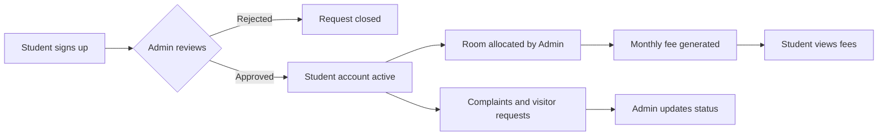
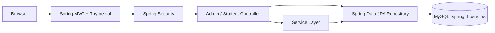
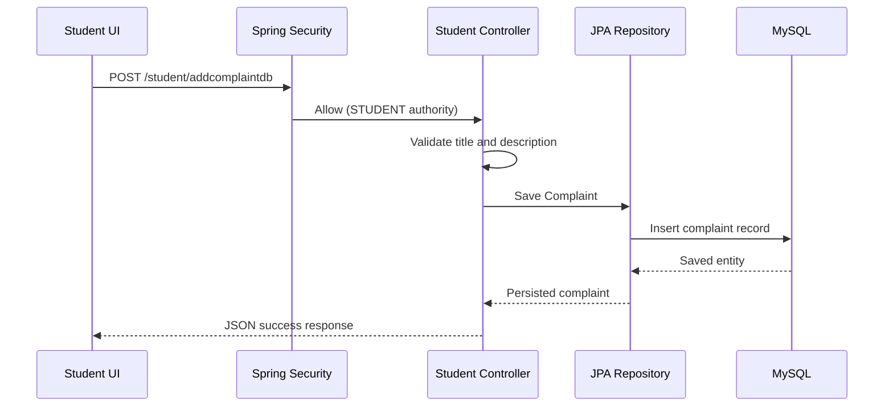

<div align="center">

# 🏠 HostelMS

**A hostel management system that takes a student from registration to room, fees and complaints, with separate Admin and Student portals.**


[Features](#-features) · [Workflow](#-how-it-works) · [Architecture](#-architecture) · [Quick Start](#-quick-start) · [API](#-api-overview)

</div>

<!-- Add a screenshot here:  -->

---

## 📌 At a Glance

| | |
|---|---|
| **Problem** | Hostel administration done manually: registrations, room records, fees, complaints and visitors |
| **Solution** | One web app with role-based portals for hostel staff and students |
| **Roles** | `ADMIN` and `STUDENT`, separated by Spring Security authorities |
| **Stack** | Java 17 · Spring Boot · Spring MVC · Thymeleaf · Spring Data JPA · MySQL |

## ✨ Features

| 🛡️ Admin Portal | 🎓 Student Portal |
|---|---|
| Approve or reject registration requests | Sign up and track registration status |
| Manage departments, courses, blocks, rooms and students | Update personal profile |
| Allocate and deallocate rooms with occupancy dates and rent | View room assignment and fee records |
| Generate monthly fees from rent, meal settings and extra charges | Submit complaints and follow their status |
| Process complaints with comments and status updates | Register visitor requests |
| Publish notices | View notices |

## 🔄 How It Works

The full journey of a student through the system:



**Fee generation:** each monthly record is calculated from the room rent, occupancy duration, meal settings and any additional charges.

## 🏗️ Architecture



**Example request: a student submits a complaint**



Spring Security restricts the route to the `STUDENT` authority. The controller validates the request, links it to the logged-in student and the selected room, and saves it through Spring Data JPA. An administrator can then view and update it from the admin portal.

## 🧰 Tech Stack

| Layer | Technology | Purpose |
|---|---|---|
| Frontend | HTML, CSS, JavaScript, Thymeleaf | Server-rendered pages and browser interactions |
| Backend | Java 17, Spring Boot, Spring MVC | Application services and web routes |
| Database | MySQL, Spring Data JPA | Persistent hostel records |
| Auth | Spring Security, BCrypt | Login, authorities and password handling |
| Tools | Maven Wrapper, Lombok, Hibernate | Build, boilerplate reduction and ORM |

## 🚀 Quick Start

**Prerequisites:** JDK 17, MySQL, Git (Maven is included through the wrapper)

```bash
# 1. Clone
git clone https://github.com/JaganRaju07/HostelMS.git
cd HostelMS

# 2. Create the database (or import the included SQL export)
mysql -u <your-username> -p -e "CREATE DATABASE spring_hostelms;"
mysql -u <your-username> -p spring_hostelms < 127_0_0_1_spring_hostelms.sql

# 3. Set database credentials (macOS/Linux)
export DB_USERNAME=<your-mysql-username>
export DB_PASSWORD=<your-mysql-password>

# 4. Run
./mvnw spring-boot:run
```

On Windows, set the variables with `set DB_USERNAME=...` and `set DB_PASSWORD=...`, then run `mvnw.cmd spring-boot:run`.

Open **http://localhost:8080**. The app connects to `localhost:3306/spring_hostelms` by default.

Run the test: `./mvnw test`

<details>
<summary><b>📁 Project Structure</b></summary>

```text
src/main/java/com/project/hostelms/   # Controllers, services, repositories, entities, security
src/main/resources/templates/         # Administrator and student Thymeleaf pages
src/main/resources/static/            # CSS, JavaScript, images and frontend libraries
src/main/resources/application.properties
src/test/java/                        # Spring Boot context test
127_0_0_1_spring_hostelms.sql         # MySQL database export
pom.xml                               # Maven dependencies and build configuration
mvnw / mvnw.cmd                       # Maven Wrapper launchers
```

</details>

## 🔌 API Overview

<details>
<summary><b>View main endpoints</b></summary>

| Method | Endpoint | Description |
|---|---|---|
| GET | `/login` | Display the login page |
| POST | `/registerdb` | Submit a student registration request |
| POST | `/checkAvailability` | Check whether an email is already registered |
| POST | `/loadcourses` | Retrieve courses for a department |
| POST | `/student/addcomplaintdb` | Create a student complaint |
| GET | `/student/complaints` | Display student complaints |
| POST | `/student/addvisitordb` | Register a visitor request |
| GET | `/admin/registrationrequests` | List pending registration requests |
| POST | `/admin/allocateroom` | Allocate or deallocate a room |
| POST | `/admin/newgeneratefees` | Generate monthly fee records |

</details>

## 🧠 What I Learned

- Used Spring Security authorities to separate administrator and student access
- Split registration and hostel logic into service and repository layers
- Built server-rendered workflows with Thymeleaf, Spring MVC and JPA entities
- Designed fee calculation around rent, occupancy duration, meal settings and extra charges

## 🔮 Future Improvements

- [ ] Add database migrations instead of relying on Hibernate schema updates
- [ ] Expand automated tests beyond the context-load test
- [ ] Reintroduce CSRF protection after configuring browser form handling
- [ ] Use the service layer consistently instead of direct repository access in controllers

---

<div align="center">

**Built by Jagan Raju B**

[GitHub](https://github.com/JaganRaju07) · [LinkedIn](https://www.linkedin.com/in/jagan-raju)

</div>
