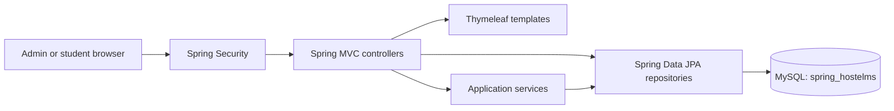

# HostelMS

A Java web application for hostel administrators and students to manage room allocation, student records, fees, complaints, visitor requests, and notices through role-specific web portals.


## Overview

HostelMS brings routine hostel administration into one server-rendered application: administrators work with student registration, rooms and allocations, fees, complaints, visitors, and notices; students can view room and fee information and submit complaints or visitor requests. Spring MVC controllers render Thymeleaf pages and handle form-backed actions, while Spring Data JPA repositories persist records in MySQL.

The repository also includes a SQL export for the `spring_hostelms` database. Review it before use: the dump contains sample user records, password hashes, and personal-looking data.

## Features

- Student self-registration creates a request for administrator review.
- Admin pages manage students, departments, courses, hostel blocks, and rooms.
- Room allocations connect students to rooms and monthly rent records.
- Admin fee workflows generate monthly charges and record payment status and method.
- Students can view room and fee history, edit profile details, and change passwords.
- Students submit complaints and visitor requests; administrators can review complaints and respond.
- Noticeboard pages provide notices to the portals.
- Spring Security assigns separate `ADMIN` and `STUDENT` authorities to protected page areas.

## Technology

| Area | Technology |
| --- | --- |
| Language | Java 17 |
| Web and views | Spring Boot 3.1.0-SNAPSHOT, Spring MVC, Thymeleaf |
| Persistence | Spring Data JPA, Hibernate, MySQL Connector/J |
| Authentication | Spring Security, BCrypt password encoder |
| Build | Maven 3.8.7 via Maven Wrapper |

## Architecture



The application entry point is `hostelmsApplication`; `AdminController` and `StudentController` handle portal routes. Controllers use repositories directly and also call service classes for some operations. Templates under `src/main/resources/templates` render the UI. `SpringSecurity` configures form login, the BCrypt encoder, and authority checks for `/admin/**` and `/student/**`.

## Getting started

### Prerequisites

- JDK 17
- MySQL server available at `localhost:3306`
- Git

The Maven Wrapper downloads Maven 3.8.7 as configured in `.mvn/wrapper/maven-wrapper.properties`.

### Clone the repository

```bash
git clone https://github.com/JaganRaju07/HostelMS.git
cd HostelMS
```

### Create and configure the database

The application connects to MySQL database `spring_hostelms`. Create it, or import the included SQL dump to create and populate it:

```sql
CREATE DATABASE spring_hostelms;
```

The dump is [`127_0_0_1_spring_hostelms.sql`](127_0_0_1_spring_hostelms.sql). Inspect it before importing; it includes sample account and personal-looking records. Do not reuse its data in a live environment.

Set database credentials in the environment before starting the application. The configuration defaults to username `root` and password `Mysql@1234` when the variables are unset; replace these defaults with local credentials.

| Variable | Purpose | Default in `application.properties` |
| --- | --- | --- |
| `DB_USERNAME` | MySQL username | `root` |
| `DB_PASSWORD` | MySQL password | `Mysql@1234` |

### Run

macOS/Linux:

```bash
export DB_USERNAME=root
export DB_PASSWORD=your-local-password
./mvnw spring-boot:run
```

Windows Command Prompt:

```bat
set DB_USERNAME=root
set DB_PASSWORD=your-local-password
mvnw.cmd spring-boot:run
```

Open <http://localhost:8080>. The repository does not document default login credentials. Use the registration flow and administrator approval, or configure an account in your local database.

## Testing

Run the Maven test phase with the wrapper:

```bash
./mvnw test
```

On Windows Command Prompt:

```bat
mvnw.cmd test
```

The checked-in test is a Spring Boot context-load test (`OsfsystemApplicationTests`). No CI workflow or lint command is present in the repository.

## Project structure

```text
.
├── .mvn/wrapper/                  Maven Wrapper configuration
├── src/main/java/com/project/hostelms/
│   ├── config/                    Spring Security configuration
│   ├── controller/                Admin and student web controllers
│   ├── dto/, entity/              Transfer objects and persistence entities
│   ├── exception/                 Exception-related classes
│   ├── repository/                Spring Data repositories
│   ├── security/                  User-details integration
│   └── service/                   Application services
├── src/main/resources/
│   ├── application.properties     MySQL and JPA settings
│   ├── static/                    Browser assets
│   └── templates/                 Thymeleaf pages
├── src/test/                      Application context test
├── 127_0_0_1_spring_hostelms.sql  Database export with sample data
├── mvnw, mvnw.cmd                 Maven Wrapper launchers
└── pom.xml                        Dependencies and build configuration
```

## Security and limitations

- `SpringSecurity` explicitly disables CSRF protection. Review and address this before exposing the application beyond a local development environment.
- `application.properties` configures Hibernate with `ddl-auto=update`; review schema-management and migration practices before using persistent or production data.
- Database connection settings default to local development credentials if environment variables are not set. Supply non-default secrets outside the repository.
- The included SQL dump contains sample user records and password hashes. Treat it as untrusted demo data, not a production database.
- The checked-in automated test covers application context startup only; it does not demonstrate end-to-end workflows or broader behavior.

## License

No licence specified. <!-- VERIFY: Add a licence file and update this section if the project is intended to be distributed under a specific licence. -->
