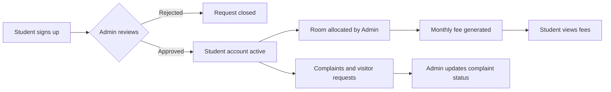
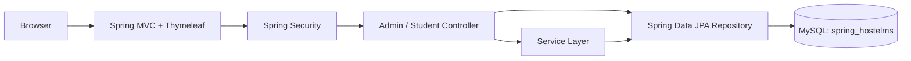
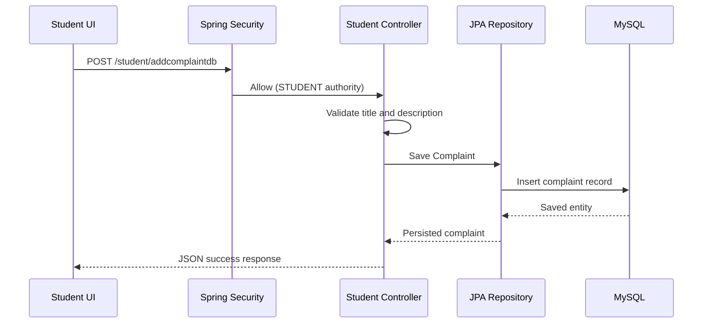

<div align="center">

# 🏠 HostelMS

**A hostel management system that takes a student from registration to room, fees and complaints, with separate Admin and Student portals.**


[Features](#-features) · [Workflow](#-how-it-works) · [Architecture](#-architecture) · [Quick Start](#-quick-start) · [Routes](#-main-routes)

</div>

<!-- Add a screenshot here:  -->

---

## 📌 At a Glance

| | |
|---|---|
| **Problem** | Hostel administration done manually: registrations, room records, fees, complaints and visitors |
| **Solution** | One web app with role-based portals for hostel staff and students |
| **Roles** | `ADMIN` and `STUDENT`, separated by Spring Security authorities |
| **Type** | Server-rendered Spring MVC monolith (Thymeleaf pages, no separate frontend app) |
| **Stack** | Java 17 · Spring Boot · Spring MVC · Thymeleaf · Spring Data JPA · MySQL |

## ✨ Features

| 🛡️ Admin Portal | 🎓 Student Portal |
|---|---|
| Dashboard with block, room, occupancy and pending-request counts | Dashboard with unpaid fees and balance |
| Approve or reject student registration requests | Sign up and submit a registration request |
| Manage blocks, rooms, departments, courses and students | View room allocations |
| Allocate and deallocate rooms | View monthly fee history and balance |
| Generate monthly fees and mark them as paid | Raise complaints and add comments |
| Reply to and update complaints | Register and remove visitor requests |
| Publish notices and manage hostel settings | Update profile and change password |
| Enable or disable student accounts | |

## 🔄 How It Works

The journey of a student through the system:



**Fee generation:** each monthly record is calculated from the room rent, occupancy duration, meal settings and any additional charges.

## 🏗️ Architecture



**Example request: a student submits a complaint**



Spring Security restricts the route to the `STUDENT` authority. The controller validates the request, links it to the logged-in student and the selected room, and saves it through Spring Data JPA. An administrator can then view and update it from the admin portal.

**Login flow:** the form posts to `/login`, handled by Spring Security. `CustomLoginsDetailsService` loads the user by username, rejects inactive accounts, and checks the BCrypt password hash. The user's type becomes the `ADMIN` or `STUDENT` authority, and the user is redirected to the matching dashboard.

## 🧰 Tech Stack

| Layer | Technology | Purpose |
|---|---|---|
| Frontend | HTML, CSS, Bootstrap, JavaScript, jQuery, Thymeleaf | Server-rendered pages and browser interactions |
| Backend | Java 17, Spring Boot, Spring MVC | Application services and web routes |
| Database | MySQL, Spring Data JPA, Hibernate | Persistent hostel records and ORM |
| Auth | Spring Security, BCrypt | Login, role authorities and password hashing |
| Tools | Maven Wrapper, Lombok | Build and boilerplate reduction |

## 🚀 Quick Start

**Prerequisites:** JDK 17, MySQL, Git (Maven is included through the wrapper)

```bash
# 1. Clone
git clone https://github.com/JaganRaju07/HostelMS.git
cd HostelMS

# 2. Create the database and import the included SQL export
mysql -u <your-username> -p -e "CREATE DATABASE spring_hostelms;"
mysql -u <your-username> -p spring_hostelms < 127_0_0_1_spring_hostelms.sql

# 3. Set database credentials (macOS/Linux)
export DB_USERNAME=<your-mysql-username>
export DB_PASSWORD=<your-mysql-password>

# 4. Run
./mvnw spring-boot:run
```

On Windows, set the variables with `set DB_USERNAME=...` and `set DB_PASSWORD=...`, then run `mvnw.cmd spring-boot:run`.

Open **http://localhost:8080**. The app connects to `localhost:3306/spring_hostelms` by default.

<details>
<summary><b>📁 Project Structure</b></summary>

```text
src/main/java/com/project/hostelms/   # Controllers, services, repositories, entities, security
src/main/resources/templates/         # Administrator and student Thymeleaf pages
src/main/resources/static/            # CSS, JavaScript, images and frontend libraries
src/main/resources/application.properties
src/test/java/                        # Spring Boot context test
127_0_0_1_spring_hostelms.sql         # MySQL database export
pom.xml                               # Maven dependencies and build configuration
mvnw / mvnw.cmd                       # Maven Wrapper launchers
```

</details>

## 🔌 Main Routes

HostelMS is a server-rendered MVC app, so these are page routes and AJAX-style endpoints rather than a standalone REST API.

<details>
<summary><b>View main routes</b></summary>

| Method | Route | Description |
|---|---|---|
| GET | `/login` | Display the login page |
| POST | `/registerdb` | Submit a student registration request |
| POST | `/checkAvailability` | Check whether an email is already registered |
| POST | `/loadcourses` | Retrieve courses for a department |
| GET | `/student/dashboard` | Show unpaid fees and balance |
| POST | `/student/addcomplaintdb` | Create a student complaint |
| POST | `/student/addvisitordb` | Register a visitor request |
| GET | `/admin/dashboard` | Show block, room, occupancy and pending-request counts |
| GET | `/admin/registrationrequests` | List pending registration requests |
| POST | `/admin/allocateroom` | Allocate or deallocate a room |
| POST | `/admin/newgeneratefees` | Generate monthly fee records |
| POST | `/admin/feespaid` | Mark a fee as paid |

</details>

## 🧠 What I Learned

- Used Spring Security authorities to separate administrator and student access
- Split registration and hostel logic into service and repository layers
- Built server-rendered workflows with Thymeleaf, Spring MVC and JPA entities
- Designed fee calculation around rent, occupancy duration, meal settings and extra charges

## 🔮 Future Improvements

- [ ] Re-enable CSRF protection and add ownership checks on student records
- [ ] Wrap room allocation and fee generation in transactions with locking
- [ ] Add pagination and replace N+1 query loops with joins
- [ ] Use Flyway migrations instead of Hibernate schema updates
- [ ] Add integration and security tests beyond the context-load test

---

<div align="center">

**Built by Jagan Raju B**

[GitHub](https://github.com/JaganRaju07) · [LinkedIn](https://www.linkedin.com/in/jagan-raju)

</div>
