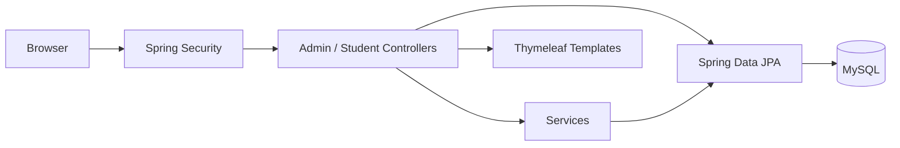

# HostelMS

A server-rendered hostel administration application where administrators manage residents and facilities, while students view allocations and fees and submit complaints or visitor requests.


## What it supports

### Administrator

- Review student registration requests and approve or reject them.
- Create and maintain departments, courses, blocks, rooms, students, and notices.
- Allocate and deallocate students to rooms, including monthly rent and occupancy dates.
- Generate monthly rent, mess, and other charges; record payment method and status.
- Review complaints and add status updates and discussion comments.
- View active visitor requests.
- Update the administrator profile and password.

### Student

- Submit a registration request and receive access after approval.
- View the current and historical room allocations.
- View monthly fee breakdown and unpaid balance.
- Lodge complaints against a room and participate in complaint comments.
- Submit visitor requests for a specified time range and remove an entry.
- Update the profile and password.

## Architecture

The application is a conventional Spring MVC web application. Thymeleaf templates are rendered on the server; Spring controllers handle form and AJAX-style POST requests, services and repositories contain application/database operations, and JPA persists entities to MySQL.



### Main package map

| Package | Responsibility |
| --- | --- |
| [`config`](src/main/java/com/project/hostelms/config) | Security filter chain and password encoder |
| [`controller`](src/main/java/com/project/hostelms/controller) | Admin and student routes and request handling |
| [`service`](src/main/java/com/project/hostelms/service) | Registration, login, and visitor-service contracts |
| [`repository`](src/main/java/com/project/hostelms/repository) | Spring Data JPA persistence queries |
| [`entity`](src/main/java/com/project/hostelms/entity) | Hostel, student, fee, complaint, visitor, and account models |
| [`templates`](src/main/resources/templates) | Server-rendered Thymeleaf pages |
| [`static`](src/main/resources/static) | CSS, JavaScript, fonts, and vendor assets |

Representative entry points:

- [`HostelMS application`](src/main/java/com/project/hostelms/hostelmsApplication.java)
- [`Spring Security configuration`](src/main/java/com/project/hostelms/config/SpringSecurity.java)
- [`AdminController`](src/main/java/com/project/hostelms/controller/AdminController.java)
- [`StudentController`](src/main/java/com/project/hostelms/controller/StudentController.java)
- [`Registration approval service`](src/main/java/com/project/hostelms/service/impl/AdminServiceImpl.java)

## Core workflows

### Authentication and role routing

1. Spring Security loads a user through [`CustomLoginsDetailsService`](src/main/java/com/project/hostelms/security/CustomLoginsDetailsService.java).
2. Only users with status `1` are accepted, and their `ADMIN` or `STUDENT` type becomes their authority.
3. `/admin/**` requires `ADMIN`; `/student/**` requires `STUDENT`.
4. The root route redirects an authenticated user to the matching dashboard; otherwise it redirects to login.

### Registration approval

1. A student completes the public signup form.
2. The request is saved with pending status in `RegistrationRequest`.
3. The administrator reviews pending requests under `/admin/registrationrequests`.
4. Approval decodes the submitted password, creates `Users` and `Student` records, and applies the `STUDENT` authority.
5. Rejection changes the request status only.

### Room allocation and fees

1. The administrator creates blocks and rooms, with a configured room capacity.
2. A student is allocated to a room by creating an active `RoomStudent` record with start date and monthly rent.
3. Deallocation updates the record with an end date and inactive status.
4. Monthly fee generation prorates rent for stay days and calculates mess charges from configured meal values; other charges are controlled by settings.
5. The administrator marks generated fees paid and records the payment method.

The fee calculation is implemented in [`AdminController.generatefees and fetchfees`](src/main/java/com/project/hostelms/controller/AdminController.java), and fee values are stored in `Studentmonthlyfees`.

### Complaints and visitors

- Students lodge complaints against an allocated room. Both the student and administrator can add complaint comments; the administrator can update complaint status.
- Students submit a visitor name, purpose, room, and valid future time range. Active entries are visible to the administrator and removable by the student.

## Technology

| Area | Technology |
| --- | --- |
| Runtime | Java 17 |
| Framework | Spring Boot 3.1.0-SNAPSHOT |
| Web | Spring MVC, Thymeleaf |
| Security | Spring Security 6 integration, BCrypt |
| Persistence | Spring Data JPA, Hibernate, MySQL Connector/J |
| Front end | HTML, CSS, JavaScript, Bootstrap, jQuery, DataTables |
| Build | Maven Wrapper; Maven 3.8.7 configured |
| Database | MySQL database `spring_hostelms` |

Versions come from [`pom.xml`](pom.xml), [`application.properties`](src/main/resources/application.properties), and [`.mvn/wrapper/maven-wrapper.properties`](.mvn/wrapper/maven-wrapper.properties). No licensed package or deployment configuration has been verified beyond these dependencies.

## Local setup

### Prerequisites

- JDK 17
- A local MySQL server
- Git

### Configure MySQL

A database schema export is available at [`127_0_0_1_spring_hostelms.sql`](127_0_0_1_spring_hostelms.sql). It creates `spring_hostelms` and includes sample records. Import it only into a disposable development database; review it before use and do not reuse the sample data in a live environment.

The application uses `spring.datasource.url=jdbc:mysql://localhost:3306/spring_hostelms`. Database username and password are read from `DB_USERNAME` and `DB_PASSWORD`; if unset, repository configuration supplies local-development defaults.

Set your own values outside the repository:

macOS/Linux:

```bash
export DB_USERNAME='your-local-user'
export DB_PASSWORD='your-local-password'
```

Windows Command Prompt:

```bat
set DB_USERNAME=your-local-user
set DB_PASSWORD=your-local-password
```

### Build and run

```bash
./mvnw clean spring-boot:run
```

Windows:

```bat
mvnw.cmd clean spring-boot:run
```

The application starts with Spring Boot on the default port `8080`. Open `http://localhost:8080`.

## Tests

The only checked-in automated test is [`OsfsystemApplicationTests`](src/test/java/com/project/osfsystem/OsfsystemApplicationTests.java). It uses `@SpringBootTest` and verifies that the application context loads; it does not cover the portal workflows, controllers, services, or database behavior.

Run the suite with:

```bash
./mvnw test
```

No checked-in CI workflow or coverage configuration was found.

## Configuration and security notes

- [`application.properties`](src/main/resources/application.properties) enables Hibernate `ddl-auto=update`. For persistent environments, review schema-management and migration practices.
- [`SpringSecurity.java`](src/main/java/com/project/hostelms/config/SpringSecurity.java) disables CSRF protection. It should be reconsidered before deployment beyond local development.
- Passwords are encoded with BCrypt for active accounts. Student signup stores a pending request password in Base64 before approval; approval replaces it with a BCrypt password.
- Keep database credentials in environment variables and do not reuse credentials or sample records from the SQL dump.
- A repository licence was not found; reuse or distribution terms are Unclear.

## Source map

- [`pom.xml`](pom.xml) — build and dependencies
- [`src/main/java/com/project/hostelms`](src/main/java/com/project/hostelms) — Java application source
- [`src/main/resources/templates`](src/main/resources/templates) — Thymeleaf views
- [`src/main/resources/static`](src/main/resources/static) — browser assets
- [`127_0_0_1_spring_hostelms.sql`](127_0_0_1_spring_hostelms.sql) — database export
- [`src/test`](src/test) — existing tests
